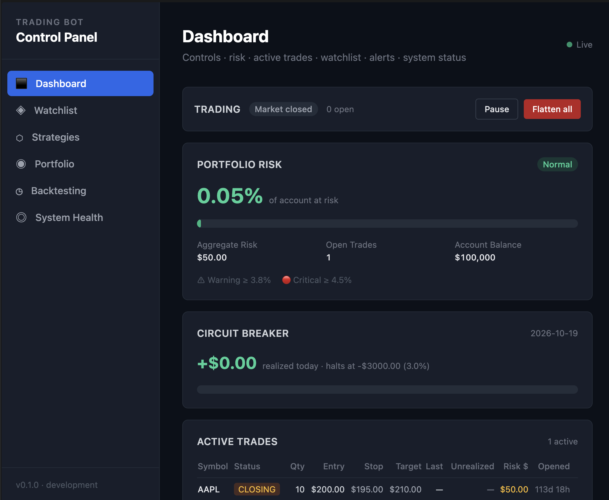

# Automated Trading Bot

Personal algorithmic trading bot for US equities, built on Interactive Brokers.



## Stack

Python 3.11 + FastAPI · PostgreSQL 15 + TimescaleDB · Redis 7 · Interactive Brokers (`ib_async`) · React 18 + TypeScript + Tailwind · Docker Compose

## Quick Start

Requires Docker, Node.js 18+, Python 3.11+.

```bash
cp .env.example .env                 # fill in values: .claude/specs/environment-setup.md
docker compose up -d db redis        # dev stack, bound to 127.0.0.1

cd backend
pip install -r requirements.txt
alembic upgrade head
uvicorn app.main:app --reload        # API :8000, docs at /docs

cd ../frontend
npm install && npm run dev           # UI :5173
```

Full containerized stack with a paper IB Gateway: [DEPLOYMENT.md](DEPLOYMENT.md).

## IB Gateway

Paper only. Never point the bot at a live port.

The Gateway runs in Docker and logs in by itself (paper username/password from `.env`), restarting daily. You only approve a login in IBKR Mobile about once a week. Quit the native Gateway app first: same login, same port.

```bash
docker compose --profile ibkr up -d ib-gateway   # development: API on 127.0.0.1:4002
scripts/bot.sh up                                # full stack, see DEPLOYMENT.md
```

| Backend runs | `IBKR_HOST` | `IBKR_PORT` |
|--------------|-------------|-------------|
| On the host (`uvicorn`) | `127.0.0.1` | `4002` |
| In `docker-compose.yml` | `ib-gateway` | `4004` |

Set `BROKER=ibkr` and `IBKR_TRADING_MODE=paper` (the full stack sets all of these itself). Live ports (4001 native, 4003 Docker) are never used. When the Gateway needs you, the dashboard banner and `scripts/bot.sh status` say what to do.

The native installers (`ibgateway-*`) are a fallback only and are gitignored; see DEPLOYMENT.md §9.

## Risk Model

- Every trade is blocked if it risks more than **1% of account balance**.
- A stop-loss is mandatory; orders without one are rejected.
- No margin: open positions plus a new trade may not be worth more than the account.

## Docs

Architecture, requirements and task tracking: `.claude/specs/`.

## Backlog

- **Options (iron condor):** options data feed, multi-leg orders and DB models, spread-based risk calculation.
- **ML signals:** feature pipeline, offline training with walk-forward validation, model registry, `MLStrategy`.
- **Mobile PWA:** manifest and service worker, responsive layout, web push (needs HTTPS).
- **Second broker (Alpaca, Tradier):** new `BaseBroker` implementation and mapper, per-broker paper-mode guard.
